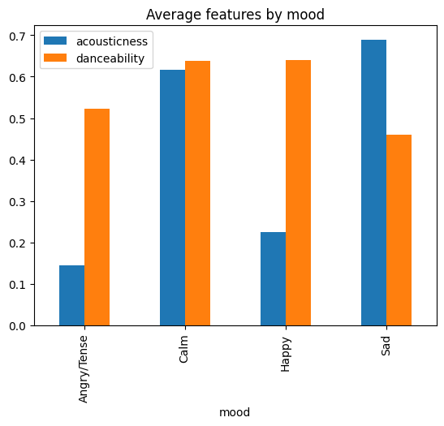
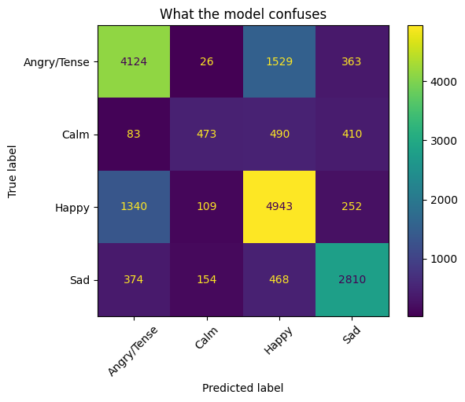
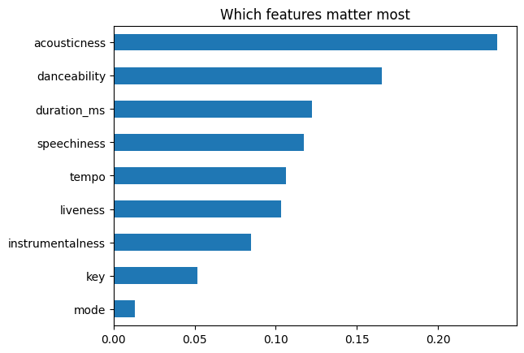

# Music Mood Classifier

A machine learning project that predicts a song's mood (Happy, Calm, Sad, Angry/Tense) from its audio features.

I'm Paavani Cotah, a BSc AI & ML student at SRM Institute of Science and Technology (Ramapuram, Chennai) and a performing musician. I wanted a first project that connects both sides of my life. The question I set out to answer: **can a model tell what mood a song has without being given the two features that define mood?**

## Dataset
[Spotify Tracks Dataset](https://www.kaggle.com/datasets/yashdev01/spotify-tracks-dataset) from Kaggle: 114,000 tracks with 22 columns (danceability, acousticness, tempo, valence, energy and others).

Cleaning steps:
- Dropped two unnamed index columns
- Removed 24,259 duplicate tracks (the same song appears under several genres)
- Dropped 1 row with missing values
- **Final dataset: 89,740 songs**

## How moods are defined
The dataset has no mood column, so I created one. Music psychology describes mood on two axes: **valence** (sad to happy) and **energy** (low to high). I split each at 0.5 to get four moods:

| | Low energy | High energy |
|---|---|---|
| **High valence** | Calm | Happy |
| **Low valence** | Sad | Angry/Tense |

Class sizes: Happy 33,220 | Angry/Tense 30,211 | Sad 19,030 | Calm 7,279. Calm is the smallest class (about 8% of the data).

## Exploratory findings

- **Acousticness** is high in the low-energy moods (Calm about 0.62, Sad about 0.69) and low in the high-energy ones (Angry/Tense about 0.14, Happy about 0.22), so it tracks energy.
- **Danceability** is nearly identical for Calm and Happy (both about 0.64) and lower for Sad and Angry/Tense (about 0.46 and 0.52), so it tracks valence more than energy.

Different features carry information about different mood axes, which suggested the model could learn mood without seeing valence or energy.

## Model
- **Random Forest classifier** (scikit-learn), 100 trees
- 80/20 train-test split, stratified by mood (17,948 test songs)
- `class_weight="balanced"` to reduce the effect of the Calm imbalance
- **Inputs:** danceability, acousticness, tempo, speechiness, instrumentalness, liveness, mode, key, duration
- **Excluded on purpose:**
  - *Valence and energy*, because the labels are calculated from them. Including them would let the model re-learn my formula and score close to 100%, which proves nothing.
  - *Loudness*, because it is strongly tied to energy and would leak information about the label. I did not test this assumption.

## Results
Overall accuracy: **69%**. For comparison, always guessing the biggest class (Happy) would give about 37%.

| Mood | Precision | Recall | F1-score | Test songs |
|---|---|---|---|---|
| Angry/Tense | 0.70 | 0.68 | 0.69 | 6,042 |
| Calm | 0.62 | 0.32 | 0.43 | 1,456 |
| Happy | 0.67 | 0.74 | 0.70 | 6,644 |
| Sad | 0.73 | 0.74 | 0.74 | 3,806 |

**What worked:** Happy, Sad and Angry/Tense are predicted reasonably well (4,943 Happy, 4,124 Angry/Tense and 2,810 Sad songs correct).

**What didn't: Calm.** Only 473 of the 1,456 Calm songs (32%) were identified. The rest were mostly predicted as Happy (490) or Sad (410), the two moods that each share one axis with Calm: Happy shares its high valence, Sad shares its low energy. Only 83 were predicted as Angry/Tense, the mood that shares neither. Calm is also the smallest class, which makes it harder to learn.

**Another pattern:** Happy and Angry/Tense are confused with each other the most (1,529 Angry/Tense songs predicted as Happy, 1,340 Happy predicted as Angry/Tense). Both are high-energy moods, and the model has no energy input to tell them apart.

**Most important feature:** acousticness, followed by danceability. Mode (major/minor) mattered least. This matches the exploratory charts. These are correlations in this dataset, not claims about what makes a song sound a certain way.

## Limitations
- The mood labels come from a simple threshold rule on valence and energy, not from human listeners. "Mood" here means a position on the valence-energy plane, and songs near the 0.5 cutoffs are labelled somewhat arbitrarily.
- Audio features are pre-computed by Spotify, not extracted by me from raw audio.
- Only one model type was tested, with default settings.

## Next steps
- Compare other models (e.g. gradient boosting) and tune hyperparameters
- Try other ways of handling the Calm imbalance, such as resampling
- Test whether adding loudness really leaks energy information
- Wrap the model in a small Streamlit app where a user can try it
- Extract features from raw audio files instead of using pre-computed ones

## Run it
Open `music-mood-classifier.ipynb` in Jupyter or Kaggle. Libraries needed: pandas, scikit-learn, matplotlib, kagglehub. The notebook downloads the dataset itself with `kagglehub`.

## About this project
This is my first ML project, built while learning Python. I used Claude as a tutor while building it, and I wrote and ran the code and interpreted the results myself.

## Author
Paavani Cotah | [GitHub](https://github.com/cotahpaavani)
